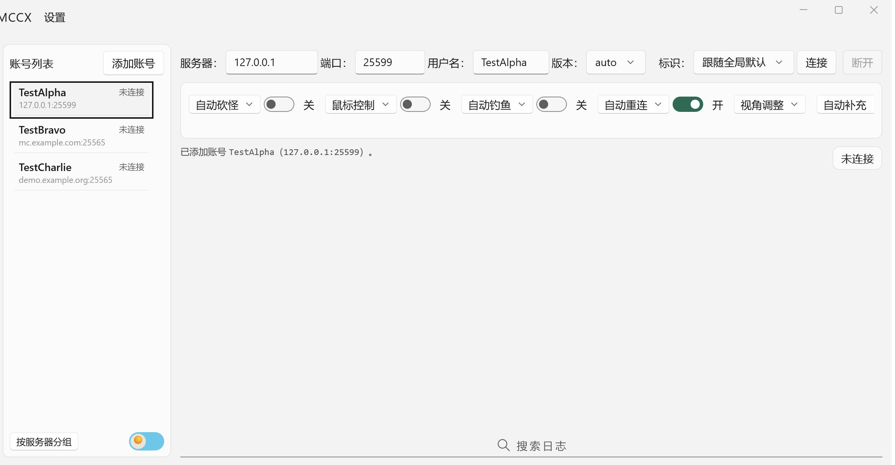
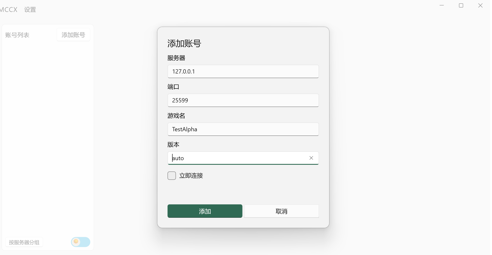
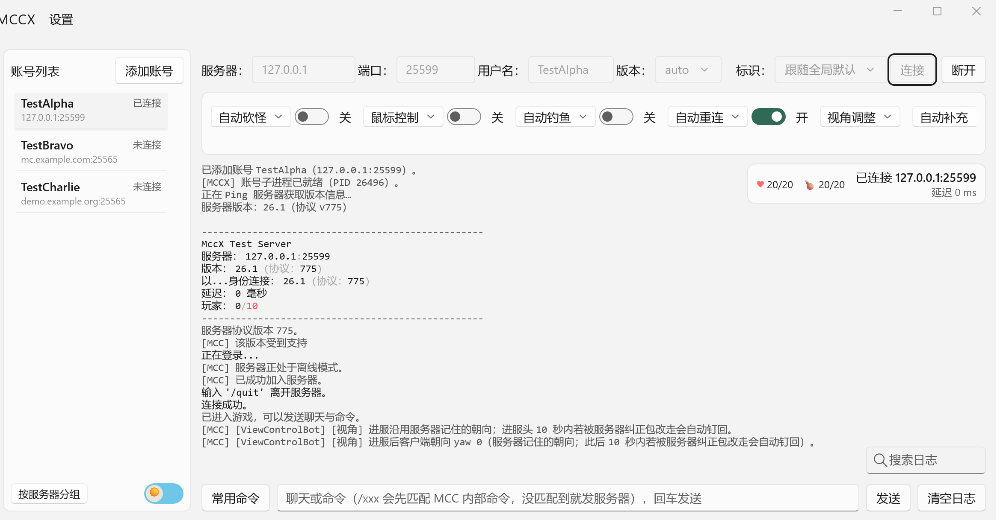
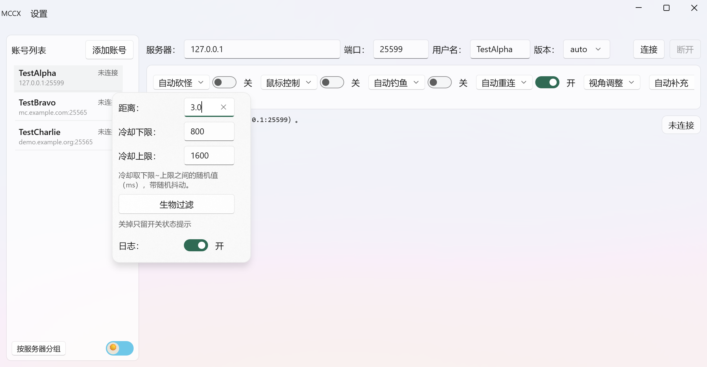
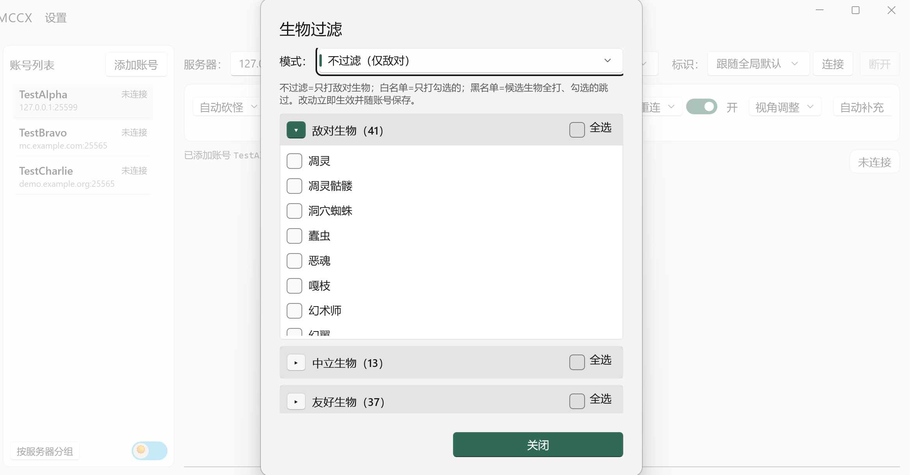
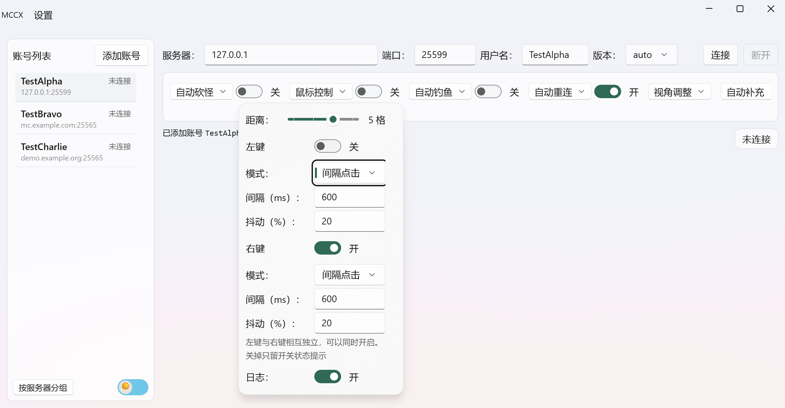
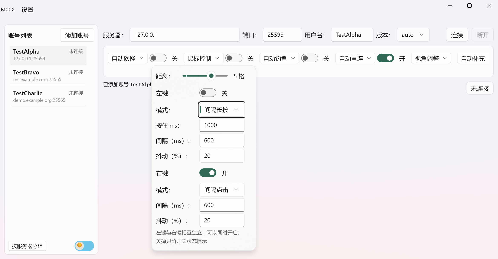
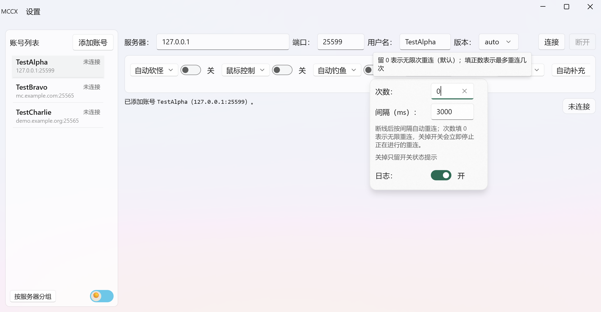
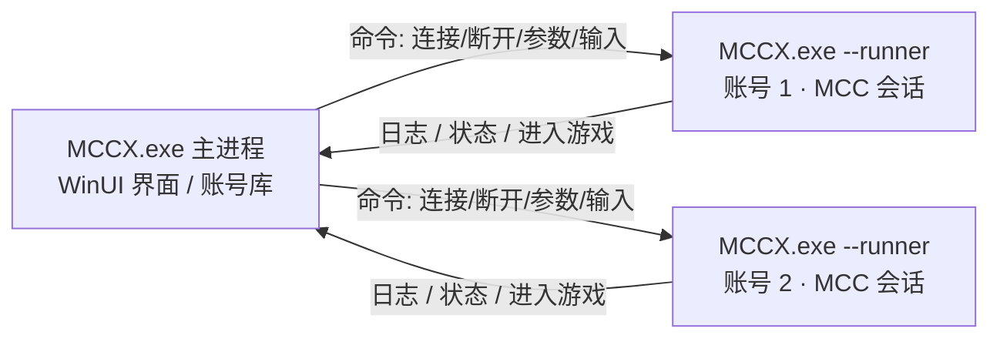

# MCCX — Minecraft 多账号挂机控制台

基于 [Minecraft Console Client](https://github.com/MCCTeam/Minecraft-Console-Client)（MCC）二次开发的 Windows 桌面挂机工具：
**多账号多开、可视化参数面板、自动化挂机**（自动砍怪 / 鼠标按键控制 / 自动钓鱼 / 自动重连 / 视角调整 / 自动补充 / 自动行走 / 自动指令），还能同步服务器容器窗口、查看自己的背包，界面为 WinUI 3（Windows 11 风格）。



---

## 目录

- [功能特性](#功能特性)
- [运行环境与启动](#运行环境与启动)
- [快速上手](#快速上手)
- [参数面板详解](#参数面板详解)
  - [自动砍怪](#自动砍怪)
  - [鼠标控制](#鼠标控制)
  - [自动钓鱼](#自动钓鱼)
  - [自动重连](#自动重连)
  - [视角调整](#视角调整)
  - [自动补充](#自动补充)
  - [自动行走](#自动行走)
  - [自动指令](#自动指令)
  - [服务器信息过滤](#服务器信息过滤)
  - [背包与容器窗口](#背包与容器窗口)
- [日志与命令](#日志与命令)
- [多开与进程模型](#多开与进程模型)
- [数据与安全](#数据与安全)
- [常见问题](#常见问题)
- [开发者说明](#开发者说明)

---

## 功能特性

- **多账号多开**：左侧账号列表一键切换，每个账号一个独立进程，互不干扰；一个账号挂一个服。
- **可视化参数**：砍怪 / 鼠标 / 重连等参数全部在面板上改，改完即下发，不用碰配置文件。
- **自动砍怪**：攻击距离、冷却随机抖动、91 种生物三分类过滤（敌对 41 / 中立 13 / 友好 37）。
- **鼠标按键控制**：左键（挖掘/攻击）与右键（放置/使用）完全独立、可同时开；三档模式 + 准星探测距离（1-7 格）+ 随机抖动。
- **自动钓鱼**：复用 MCC 内置 AutoFishing，可调声音 / 实体检测、超时与重抛间隔，开箱即用。
- **自动重连**：默认**无限次**重连（次数填 0），也可指定上限；关掉开关会**立即停止**正在进行的重连。服务器换端口时，自动重连会重新查 SRV 记录并跟随新端口。
- **视角调整**：弹层里 6 个方向按钮（东 / 南 / 西 / 北 / 抬头 / 低头）和一个「视角日志」开关，点一下转一次身；进服时沿用服务器记住的朝向，个别服务器登录后会把视角纠回正南，程序在进服后 10 秒内会挡回去，之后不再干预。
- **自动补充**：快捷栏手上的物品用完、放完或损坏时，自动从背包把同类物品补回手上。
- **自动行走**：一直朝当前朝向前进，配合「视角调整」的方向按钮换向。
- **自动指令**：弹层里随需新建多条指令（`/` 开头先当 MCC 内部命令、不是内部命令才当服务器指令，其余当聊天发），每条自己的**启用开关**、**间隔（秒）**、**进服立即执行**、**执行方式（循环 / 只执行一次）**、**循环次数（默认无限）**与**日志开关**相互独立；卡片上的总开关管整组。
- **服务器信息过滤**：按方式屏蔽服务器刷屏消息（全屏蔽 / 屏蔽玩家消息 / 只显示·只屏蔽指定前缀），只管服务器消息进不进日志，连接提示与 Bot 日志照常。
- **账号列表管理**：「按服务器分组」把同一服务器的账号归进一个组（组头显示域名）；列表底部还有**暗色模式**开关（月亮 / 太阳小图标），界面配色随程序记忆。
- **服务器对话框**：服务器弹出登录 / 密码框时界面同步弹窗填写——密码框遮蔽输入，取值直接回写 MCC，**不进日志、不会被当聊天发出去**。
- **容器窗口与背包联动**：服务器打开箱子 / 商店等 GUI 时界面同步弹出窗口，格子里是原版材质 + 中文名（物品是 16px 像素画、方块是平铺贴图，程序自己下载缓存，不用准备任何东西）；左键拿起 / 放下、右键分一半、Shift+左键快速移动都在真窗口上操作。窗口下面**一并画出自己的物品栏**（27 格背包 + 9 格快捷栏），点哪一格就操作哪一格——和游戏里开箱子时下面那块一模一样。窗口按蒙板弹窗的样子弹出（同「添加账号」的观感）：盖住功能区、日志区和命令栏，账号列表与连接参数（服务器 / 端口 / 用户名 / 版本 / 客户端标识 + 连接 / 断开）留在蒙板外面，所以面板开着时照样能切账号、点断开；Esc 或右上角「关闭」收起。
- **背包面板**：点功能区**「背包」**就能看自己的背包（服务器实时同步）。界面按**原版背包**的样子摆：顶上一行是装备（头盔 / 胸甲 / 护腿 / 靴子，横排）与右边空一小段挂着的副手、下面 3×9 背包、再下面 1×9 快捷栏；不做右侧的合成台（这里点不出配方），也不摆玩家人像那块。点格子 = 拿着 / 放下，和游戏里一样。
- **日志体验**：连续重复日志自动合并成 `xN`（`xN` = 这条内容累计出现 N 次），新日志自动滚到最新；日志里的网址带下划线提示，**Ctrl + 左键**一键打开；连上服务器后底部出现输入框，直接聊天或敲 MCC 命令。日志里的物品名由 MCC 按**官方简体中文语言表**翻（`item.minecraft.diamond_sword` → `钻石剑`；官方表里没有的新版物品仍按翻译键显示），服务器自定义名等原样保留。
- **日志搜索**：日志区右下角搜索框，**输入即筛**——只看命中的行，徽标显示「命中 n/N」（收起时贴框左侧，展开时浮在框顶左角上方）；回车跳下一个命中、Shift+回车跳上一个，Esc 清空并恢复整份日志、自动贴回最新。连上服务器时它收在右下角；断开后**不收起**，会逐渐展开到整个命令区（宽度覆盖整行、高度与命令输入框一致），展开后只留一条底边框、框内「搜索日志」提示居中并加大字间距，点进去输入时底色与日志区一致（不会变白底），离线也能翻旧日志；重新连上时同样用动画收回右下角。
- **命令栏**：连上服务器后底部出现输入框，回车发聊天、MCC 内部命令或服务器指令；**↑ / ↓** 翻历史（每个账号独立，最多 100 条），打字弹候选（MCC 内部命令 + 服务器指令 + 常用命令，↑ / ↓ 选择、Tab 填入），左侧「常用命令」可手动增删、只填进输入框不直接发送。断开后命令栏隐藏（那一行留给展开的日志搜索框）。
- **过程日志可关**：砍怪 / 鼠标 / 钓鱼等每个功能的逐条过程日志，都能在各自参数弹层里单独关掉（`自动砍怪日志`、`鼠标控制日志`…）。关掉后这些日志**在会话里就不再产生**（不是先发出来再隐藏），只留开启 / 关闭状态提示；开关按账号记住，重连后照样生效。
- **设置菜单**：标题栏 `MCCX` 旁有纯文字「设置」菜单，内含 **Debug 模式** 开关——平时保持关闭；排查连接问题时打开，日志里才会出现网络循环退出原因、包级收发等底层信息。菜单里还有 **客户端标识**（`minecraft:brand`）的**全局默认值**——默认 `vanilla`，与官方客户端一致；部分服务端（例如自带多版本层的）只给 `vanilla` 的客户端下发「打开界面」包，用 MCC 原始标识会导致 `/pv`、`/linggen` 这类服务端 GUI 不弹面板。需要伪装成 MCC 时切 `mcc`，或选 `empty` 不发送标识。每个账号的连接参数行还有独立的「标识」下拉（跟随全局默认 / vanilla / mcc / empty），按账号保存在加密账号库里；改完对下一次（重）连生效。
- **账号加密持久化**：账号库 AES 加密存在 `UserData\` 文件夹（便携包里与包根 `MCCX.exe` 平级）；MCC 的配置只在内存里初始化，程序**不写任何 ini**。

---

## 运行环境与启动

**发行版怎么用**：发布包是一个**便携文件夹**（不是安装器，也不是单 exe）——解压到任意目录，双击包根的 `MCCX.exe` 即可启动。包根只放启动文件、用户数据和一个程序目录，一眼就能找到：

```
MCCX\
├─ MCCX.exe        ← 双击这个启动（启动器）
├─ UserData\       ← 账号与设置（首次运行自动生成）
├─ .mccx-layout    ← 布局标记（隐藏文件，别删）
└─ app\            ← 程序本体与全部运行文件，平时不用管
```

- `MCCX.exe` 是启动器，负责拉起 `app\MCCX.exe`；真正的程序在 `app\` 里，多开子进程也从那里起。
- `.mccx-layout` 让主程序知道数据该放包根（而不是 `app\` 里），删了就会在 `app\` 里另建一份 `UserData\`。
- 整个文件夹可以随便搬，账号库跟着 `UserData\` 一起走。
- **升级**：换掉包根的 `MCCX.exe` 和整个 `app\`，`UserData\` 原地保留即可。

**系统要求**

| 项目 | 要求 |
| --- | --- |
| 操作系统 | **64 位** Windows 10 1809（17763）及以上 / Windows 11；不支持 32 位系统、Windows 10 S 模式 |
| 运行时 | 需要装三样（x64）：① [.NET 10 桌面运行时](https://dotnet.microsoft.com/download/dotnet/10.0) ② [ASP.NET Core 运行时 10](https://dotnet.microsoft.com/download/dotnet/10.0)（MCC 内置的 MCP 服务用到，桌面运行时**不包含**它）③ [Windows App Runtime 2.5.1 x64](https://aka.ms/windowsappsdk/2.5/2.5.1/windowsappruntimeinstall-x64.exe)（或到 [下载页](https://learn.microsoft.com/windows/apps/windows-app-sdk/downloads) 选 2.5.1 的 x64 安装包） |
| 网络 | 能访问目标 Minecraft 服务器（Java 版） |

> 启动报“此应用无法在你的电脑上运行”= 系统是 32 位 / 版本低于 1809 / 处于 S 模式，属于系统不满足；
> 报“必须安装或更新 .NET”并列出 `Microsoft.AspNetCore.App` = 缺上面第 ② 项；
> 报 “Required components of the Windows App Runtime are missing / Version 2.x (MSIX package version >= 2.5.1.0)”
> 并问 “Do you want to install a compatible Windows App Runtime now?” = 缺第 ③ 项，点「是(Y)」会打开官方安装包；
> 装完不用重启，重新双击包根 `MCCX.exe` 即可。

**从源码构建运行**

```powershell
# 需要 .NET 10 SDK（含 Windows 桌面工作负载）
dotnet build MCCX.slnx -c Release

# 构建产物（x64）
MCCX.App\bin\Release\net10.0-windows10.0.26100.0\win-x64\MCCX.exe
```

双击上面这个 `MCCX.exe` 即可启动（无需管理员权限）。源码直接运行时没有启动器布局，数据就放在 exe 同级的 `UserData\`；要生成上面那种便携包，用 `build\publish.ps1`（见开发文档 §12）。会写盘的东西都集中在数据目录里：

| 位置 | 文件 | 说明 |
| --- | --- | --- |
| 包根 `UserData\`（源码运行时是 exe 同目录） | `accounts.dat` / `accounts.key` | 加密账号库（服务器、用户名、各功能参数、客户端标识等；密钥随机生成，删掉即清空账号） |
| 包根 `UserData\` | `ui-settings.json` | 界面设置：暗色模式、账号是否按服务器分组、Debug 模式、客户端标识的全局默认值 |
| 包根 `UserData\` | `frequent-commands.json` | 常用命令历史 |
| 包根 `UserData\` | `item-icons-v3\`、`lang\zh_cn-<版本>.json` | 容器窗口 / 背包面板的物品图标与中文名缓存（自动下载） |
| 包根 `app\lang\`（源码运行时是 exe 同目录 `lang\`） | `zh_cn.json` | MCC 官方语言表缓存：日志里的物品名靠它翻成中文（第一次连接时下载） |

账号库与配置类文件全部集中在 `UserData\` 文件夹里，**换新版时只需把这个文件夹拷进新版包根**（散落在程序目录根下的同名文件会在首次启动时自动搬进来）。程序不写 `MinecraftClient.ini` 之类的配置文件，MCC 的配置只在内存里初始化。

> 登录目前仅支持**离线模式**（填写任意用户名即可），目标服务器需允许离线登录。

---

## 快速上手

### 1. 添加账号

左侧标题栏点 **“添加账号”**，填写服务器、端口、用户名（版本默认 `auto` 自动协商），可勾选“立即连接”：



- **端口留空** = 自动：先查 `_minecraft._tcp` 的 DNS SRV 记录，查不到回退 `25565`。自动重连时也会重新查 SRV（首次立即查，之后每 30 秒最多一次），服务器换端口后能自动跟随；只对域名地址生效，IP / localhost 不查。
- 要固定端口（如 `25565`、`25599`）直接填数字即可。
- 删除账号：悬停列表项点右侧 **✕**，二次确认后会关闭该账号进程并从账号库移除。
- 账号多了可用列表底部的 **“按服务器分组”** 收纳；同一台服务器（域名 / IP 相同）的账号归进一组，组头显示域名。

### 2. 连接 / 断开

选中账号 → 右上参数行点 **“连接”**。连接状态与延迟**浮在日志区右上角**（不占布局行、不挡鼠标选中）：

```
连接中… → 已连接 <主机>:<端口> → 断开中… → 未连接
```



- 点 **“断开”** = 踢下线并关闭该账号的子进程（等价于客户端正常退出）。
- 连上之后**服务器 / 端口 / 用户名 / 版本 / 标识五个框会变灰**（连接中、已连接、断开中都不能改，只有彻底断开才能编辑）——想换服先点“断开”。
- 参数行里「版本」后面的 **「标识」** 决定进服时发给服务端的客户端标识（`minecraft:brand`），按账号保存：

| 选项 | 发送内容 | 说明 |
| --- | --- | --- |
| 跟随全局默认 | 读「设置」菜单里的全局值（默认 `vanilla`） | 新账号的默认值 |
| vanilla（原版标识） | `vanilla` | 与官方客户端一致，服务端插件按原版放行 |
| mcc（Minecraft-Console-Client/版本） | `Minecraft-Console-Client/<版本>` | 暴露 MCC 标识 |
| empty（不发送标识） | 不发送 | 个别服务端不需要该字段 |

- **标识只在进服时发一次**：连接中不能改，改完对下一次（重）连生效；自动重连沿用该账号的选择。
- **命令栏只在连上之后出现；日志搜索框一直在**（连上时收在右下角，断开后逐渐展开到整个命令区、宽度覆盖整行，展开态只留底边框且提示居中；连上时动画收回右下角）：底部输入框发聊天 / MCC 命令，右下角是搜索框（见[日志与命令](#日志与命令)）。
- 关闭整个窗口 = 断开**所有**账号并立即退出，不残留进程。

---

## 参数面板详解

功能卡片一排开关（未选中账号时右侧为空白页），一行放不下可左右滚动露出：

```
[自动砍怪 ▾] [开关]   [鼠标控制 ▾] [开关]   [自动钓鱼 ▾] [开关]   [自动重连 ▾] [开关]
[视角调整 ▾]           [自动补充 ▾] [开关]   [自动行走 ▾] [开关]   [自动指令 ▾] [开关]
[服务器信息过滤 ▾]     [背包]
```

带 `▾` 的点**文字**展开参数弹层；`[开关]` 只启停对应功能。**视角调整**与**服务器信息过滤**没有开关——前者点开是 6 个方向按钮和视角日志开关，后者点开直接是过滤设置。`[背包]` 是按钮，点开看自己的背包（见 [背包与容器窗口](#背包与容器窗口)）。

### 自动砍怪



| 参数 | 含义 |
| --- | --- |
| 距离 | 攻击距离（格），只打这个范围内的生物 |
| 冷却下限 / 上限 | 每次攻击间隔在下限~上限毫秒之间**随机取值**（防固定节奏） |
| 生物过滤 | 打开过滤弹窗（见下） |

冷却随机 + 目标过滤，避免“机器人式”匀速清屏。

**生物过滤**弹窗按 敌对（41）/ 中立（13）/ 友好（37）三类展开收起，支持分类全选；顶部“过滤模式”三选一：



| 过滤模式 | 行为 |
| --- | --- |
| 不过滤（仅敌对） | 只打敌对生物，中立/友好不碰（默认） |
| 白名单（只打勾选的） | 只攻击你勾选的生物 |
| 黑名单（勾选的不打） | 勾选的全部跳过 |

### 鼠标控制

左右键**完全独立**、可以同时开启，参数各用各的。



**距离（滑动条）**：准星探测距离 1-7 格，默认 5。左键挖/右键交互都只认准星方向这个距离内的方块，空处则挥手/用物品。

> ⚠️ 原版交互距离约 **4.5 格**：超过 4.5 的部分属于超距操作，部分服务器 / 反作弊插件会拒绝，建议按目标服实测调整。

**三档模式**（每个按键各自选择）：

| 模式 | 行为 | 显示的参数 |
| --- | --- | --- |
| 长按 | 一直按住不松手（左键=持续挖，右键=持续使用） | 只有抖动 |
| 间隔点击 | 每隔“间隔”毫秒瞬时点一下（**不看按住值**） | 间隔、抖动 |
| 间隔长按 | 每次按住“按住”毫秒，松开后再等“间隔”毫秒 | 按住、间隔、抖动 |

**按住 / 间隔行按模式显隐**——不生效的参数直接藏起来，避免误导：

- 长按 → `按住`、`间隔` 都隐藏；
- 间隔点击 → 只显示 `间隔`（`按住 ms` 是间隔长按的参数，隐藏且**不参与**点击节奏）；
- 间隔长按 → 两个都显示。



**抖动 %**：对间隔施加 ±N% 随机扰动（0-90），降低固定频率特征。

日志里可直接看到每次触发：

```
[鼠标] 已开启：左键 / 间隔点击每 600 ms 点一次…；右键 / …（探测距离 5 格）
[鼠标] 右键 点击（指向方块）
[鼠标] 破坏方块 stone（12, 64, -8）
```

嫌逐条刷屏，可在鼠标控制弹层里关掉 **「鼠标控制日志」**——关掉后这类过程日志不再产生，只留开启 / 关闭状态（状态提示照常）；砍怪、钓鱼、重连等功能也各有自己的日志开关。

### 自动钓鱼

点「自动钓鱼」文字展开弹层，开关即用（**手中持有钓竿**）：复用 MCC 内置 **AutoFishing** Bot——开启后自动抛竿，咬钩自动收竿并再次抛出，钓竿损坏时自动切换备用竿。

| 参数 | 含义 |
| --- | --- |
| 声音检测（水花声） | 听到浮漂附近的水花声就收杆（默认开） |
| 实体检测（浮漂速度） | 按浮漂速度包判断咬钩，水面被挡住时更稳（默认开） |
| 超时（秒） | 多久没咬钩算超时并重新抛竿（5 ~ 86400，默认 300） |
| 重抛间隔（秒） | 收杆后 / 超时后隔多久重新抛竿（0 ~ 60，默认 0.4） |
| 日志 | 这条功能的过程日志开关（关掉只留开关状态提示） |

- 浮漂位移检测（咬钩下沉）**始终开启**，声音 / 实体是额外的两种检测方式。
- 参数默认值与 MCC 配置一致；留空或填错会退回默认值，改完随账号保存。

### 自动重连



| 参数 | 含义 |
| --- | --- |
| 次数 | 断线后最多自动重连几次；**填 0 = 无限重连（默认）** |
| 间隔 ms | 两次重连之间的等待毫秒数 |

> 关掉「自动重连」开关会**立即停止**正在进行的重连；开着时它会一直重试直到连上（次数为 0 时）。
>
> 每次自动重连前会重新解析 `_minecraft._tcp.<域名>`（首次立即查，之后每 30 秒最多一次）：SRV 端口和账号里存的不一样就自动改用新端口，并把新端口写回账号。只对域名地址生效（IP / localhost 不查 SRV），手动连接仍是「端口框优先、为空才查 SRV」。

### 视角调整

点「视角调整」文字展开弹层，里面是 **6 个方向按钮**加一个「视角日志」开关：

| 按钮 | 行为 |
| --- | --- |
| `视角向东` / `视角向南` / `视角向西` / `视角向北` | 水平转向，点一下转一次 |
| `视角抬头看天` / `视角低头看地` | 保留当前朝向，只把俯仰打到顶 / 底 |

- 转过去后会在 **2 秒**内保持住（防止自动行走等每 tick 写朝向把它顶回去）；转过的朝向随位置包同步给服务器，下次进服照旧沿用。
- **进服不自动改视角**：服务器在玩家数据里记着上次退出的朝向并原样发回来，程序照单应用；个别服务器登录后还会再推一个“正南”纠正包，程序在进服后 **10 秒**内把朝向钉回登录时的方向，窗口过后完全放手。
- 弹层**点方向按钮不会自己收起**，方便连点几个方向。

### 自动补充

快捷栏手上（当前选中格）的物品**用完 / 放完 / 工具损坏**时，自动从背包找同类物品补到手上：

- 优先从**主背包**（快捷栏上方那 3 格 × 9 列）找，没有再看其他快捷栏格；**副手不补**。
- 补货 = 两次左键（从源格拿起 → 放进空出的手持格），做完光标回到空闲状态。
- 守卫：光标上正拿着东西、或开着箱子 / 容器界面时**不动手**。

### 自动行走

开关即用，没有行走参数（弹层里只有「自动行走日志」开关）：一直朝当前朝向前进。想换方向就点「视角调整」弹层里的方向按钮，它按新朝向继续走。

### 自动指令

点「自动指令」文字展开弹层，里面可以**新建任意多条指令**；卡片右侧的总开关管整组（关掉就全部停），每条指令另外有自己的执行开关。

| 项 | 含义 |
| --- | --- |
| 指令 | 要发的内容：**`/` 开头先当 MCC 内部命令**（如 `/useitem`、`/send`），不是内部命令才当**服务器指令**（如 `/spawn`、`/kit`）；不带 `/` 的当聊天发——和命令栏回车走同一条路 |
| 启用 | **这条自己的**执行开关（每行一个，互不影响）：关掉只停这一条，总开关和其它指令照常；「进服立即执行」和定时执行都受它管 |
| 间隔（秒） | 这条指令自己的执行间隔（1 秒 ~ 24 小时）；每条互不影响 |
| 进服立即执行 | 这条自己的开关：勾上后每次**真正进入游戏**先跑一次，之后按下面的执行方式继续 |
| 执行方式 | **循环执行**（默认）或**只执行一次** |
| 次数 | 只在「循环执行」时出现：这条总共执行几次；**留空 = 无限**（默认）。每次进服从 0 重新计数，勾了「进服立即执行」也算一次 |
| 日志 | **这条自己的**过程日志开关（每行一个，互不影响）；关掉后这条照发，只是不打印 `[自动指令]` 行 |
| 新建指令 / × | 加一条 / 删掉这一条 |

- 先连上再打开总开关也**立刻生效**，不用重连；断线重连后按各条的设置继续（次数也重新算）。
- `/useitem` 是**直接用掉手上的物品**（不带坐标时）：末影珍珠、食物、烟花这类“用一下”的道具会真正消耗；方块照样放得下去（服务端按你的视线决定放哪）。想明确对着某一块方块用，用 `/useblock <x> <y> <z>`。命令栏里敲 `/useitem` 和自动指令里是同一套行为；手上（当前选中格）是空的会直接提示“手上没有物品”，不会假装成功。
- 会杀连接/进程的 MCC 内部命令（`/quit`、`/reconnect`、`/exit` 等）不会执行，和命令栏的拦截表是同一份。
- 指令、间隔、每行的「启用」「进服立即执行」与「日志」开关、执行方式与次数都随账号保存，重启程序照旧。
- 改弹层里任何一格都会让次数重新算起（等于重新应用这份设置）。

### 服务器信息过滤

管**服务器发来的消息**进不进日志——连接提示、Bot 日志、开关状态不受影响。过滤方式五选一：

| 方式 | 行为 |
| --- | --- |
| 不过滤 | 服务器消息全部照常显示（默认） |
| 全屏蔽 | 服务器消息一律不进日志 |
| 屏蔽玩家消息 | 滤掉玩家聊天，系统提示等照常 |
| 只显示指定前缀 | 只有命中前缀列表的消息显示 |
| 只屏蔽指定前缀 | 命中前缀列表的消息不显示 |

两个前缀列表各自独立保存：选「只显示指定前缀」用显示列表，选「只屏蔽指定前缀」用屏蔽列表，切换方式时各用各的、互不覆盖。

前缀可写多个，用**换行 / 逗号 / 顿号 / 竖线**分隔，命中任一项即按所选方式处理。列表长了嫌输入框窄，点框**右端的展开图标**（⤢）打开多行编辑窗，一行写一个更清楚（保存时自动合并成一行）。

### 背包与容器窗口

功能区最右的 **「背包」** 按钮看自己的背包（服务器实时同步）：按**原版背包**摆——顶上一行是装备（头盔 / 胸甲 / 护腿 / 靴子，横排）与右边挂着的副手，下面 3×9 背包、再下面 1×9 快捷栏；不做合成台、不摆玩家人像。

服务器打开箱子 / 商店这类 GUI 时，界面会**自动弹出同一个窗口**，窗口下面一并画出自己的物品栏：

- 格子里的物品是原版材质 + 中文名（程序自己下载缓存，不用准备任何东西）；
- **左键**拿起 / 放下，**右键**分一半，**Shift + 左键**快速移动整摞；
- 面板是蒙板弹窗，只盖功能区 / 日志区 / 命令栏——账号列表与连接参数留在外面，面板开着照样切账号、点断开；
- **Esc** 或右上角「关闭」收起；关服务器窗口时面板自动收起。

---

## 日志与命令

- **重复合并**：连续相同的日志不刷屏，就地合并为 `xN`；**`xN` 表示这条内容累计出现了 N 次**（首条不带后缀，出现第 2 条就变成 `x2`）。
- **选中与复制**：日志可以随意框选（支持跨行拖选），**右键 → 复制**复制选中的内容（没有选中时复制光标所在的整行）；`Ctrl+C` 复制、`Ctrl+A` 全选，快捷键在右键菜单里也标着。点击日志只是定位光标，阅读位置不会乱跳。
- **点击链接**：带下划线的网址（`http(s)://…`、`www.…` 以及裸写的常见域名）**按住 Ctrl 点一下**即可在浏览器打开；一行里有多个网址时，点哪个开哪个。
- **搜索日志**：搜索框常驻——连上服务器时收在**日志区右下角**，断开后不收起、会逐渐展开到整个命令区（宽度覆盖整行、高度与命令输入框一致；展开态只留一条底边框、框内提示居中并加大字间距，点进去输入时底色与日志区一致、不变白底），重新连上时动画收回右下角。输入即筛（大小写不敏感的子串命中，只显示命中的行）；徽标显示 **命中 n/N**（收起时贴框左侧，展开时浮在框顶左角上方），输入框里**回车**跳下一个命中、**Shift + 回车**跳上一个，**Esc** 清空搜索并恢复整份日志、自动贴回最新。
- **物品名显示中文**：日志里的物品名由 MCC 自己按**官方简体中文语言表**翻（游戏语言钉成 `zh_cn`，第一次连接时联网下、缓存在程序目录 `lang\zh_cn.json`，便携包里是 `app\lang\`），MCCX 不做二次改文本：`item.minecraft.diamond_sword` → `[钻石剑]`。MCC 自带的官方表是 1.19.3 的，1.20+ 的新物品（如金矛）表里没有，MCC 就原样打出翻译键；服务器自定义名与 `[系统]` 这类标签本来就不是翻译组件，原样显示。
- **关闭过程日志**：每个功能的逐条过程日志都能在自己的参数弹层里关掉（`自动砍怪日志`、`鼠标控制日志`、`自动钓鱼日志`、`自动重连日志`…）。开关控制的是**日志的发出**：关掉后这些行在会话里就不再产生，只留状态提示（已开启 / 已关闭 / 已就绪）；服务器消息用「服务器信息过滤」。
- **底部输入框**：连上服务器后出现（断开后这一行让给展开的日志搜索框）；回车发送聊天；`/` 开头先当 MCC 内部命令（如 `/inventory`、`/useitem`），不是内部命令才当服务器指令发（如 `/spawn`、`/kit`）；不带 `/` 当聊天。
- **命令历史**：输入框里按 **↑ / ↓** 翻历史（每个账号独立，最多 100 条，连续重复的不堆两条；翻过最新一条恢复正在打的半截输入）。
- **命令建议**：在输入框里打字会弹出候选（MCC 内部命令、服务器声明的指令与已记录的常用命令），**↑ / ↓** 选择、**Tab** 填入、**Esc** 关闭；候选只是补全，不会自动发送。
- **常用命令**：输入框左侧 **“常用命令”** 按钮——下拉里选一条**只填进输入框、不直接发送**，可手动添加、✕ 删除；`/` 开头的命令自动记录（`//` 开头、`login` / `password` 等口令类除外），聊天内容不记录。
- **服务器对话框**：服务器弹出登录 / 密码对话框时，界面同步弹一个对话框填写，密码框遮蔽显示；取值直接回写 MCC，**不经过聊天框**。
  - 密码框右边的**眼睛按钮**点一下变明文（常驻显示，再点一下回到遮蔽），方便核对有没有打错。
  - 密码框下方两个勾选框：**记住密码** / **自动登录**（后者要勾了「记住密码」才可选）。勾上以后，**再弹密码框时**（比如掉线重连后）会**自动填入记住的密码、等 1 秒自动点登录**；这 1 秒里手动改了密码就以手动为准。
- **清空日志**：命令栏最右的按钮（连上服务器后可见），只清当前账号的显示，不影响连接。

---

## 多开与进程模型

一个账号 = 一个独立的 MCC 会话子进程（同一个 `MCCX.exe --runner`），主进程只负责界面与调度，通过匿名管道收发命令与日志：



- 某个账号的子进程崩了只影响该账号，面板会提示“账号进程异常退出”，点“连接”可重新拉起。
- 主窗口关闭时按账号逐一发退出命令并等待回收（毫秒级），随后主进程直接结束。
- 主进程**异常结束**（任务管理器强杀、界面卡死后被杀）时，子进程会跟着一起退出：子进程挂在 Windows **Job 对象**里（主进程一没句柄释放就整组杀掉），子进程自己还每秒轮询一次父进程 PID 兜底。所以不存在“窗口关了，账号还挂在服务器上”的孤儿进程。
- 点**断开**后如果 5 秒内服务器还没确认断开，就直接杀掉这个账号的子进程（宁可重连一次，也不留一个半开的连接）。

---

## 数据与安全

- **账号库加密**：`accounts.dat`（密文）+ `accounts.key`（随机会话密钥）保存在包根 `UserData\` 文件夹里（源码运行时是 exe 同目录），二者缺一不可读。
- **不写配置文件**：程序不读也不写 `MinecraftClient.ini` 之类的配置文件——MCC 的配置（语言、地形 / 背包 / 实体处理等）只在子进程的内存里初始化。
- **密码默认不落地**：服务器对话框里的密码遮蔽输入，只回写给 MCC，不进日志、不进聊天、不写任何文件；只有主动勾选**「记住密码」**才会随该账号加密保存在 `accounts.dat` 里（勾选框随时可取消，取消后下次提交就把存着的密码清掉）。
- **防封抖动**：攻击冷却随机区间、点击间隔 ±% 抖动都是为降低固定节奏特征设计的；**不保证**绕过任何反作弊，请遵守目标服务器规则、合理设置频率。
- **超距提醒**：鼠标距离 > 4.5 格属于超距，可能被服务器拒绝。

---

## 常见问题

**Q：端口该填什么？**
留空 = 自动（DNS SRV → 25565）；服务器给了固定端口就直接填。自动重连同样会重新查 SRV，换端口能自动跟上。

**Q：服务端 GUI（`/pv`、`/linggen` 等）不弹？**
部分服务端只对特定客户端标识下发「打开界面」包。把该账号参数行里的「标识」设为 `vanilla`（或「跟随全局默认」且全局值也是 `vanilla`）后重连试试；`empty` 是不发送标识，`mcc` 会暴露 MCC 标识。

**Q：连接超时 / 进不去？**
依次检查：版本选 `auto` 是否协商成功（看日志第一行协议版本）、服务器是否为 Java 版、是否允许离线登录、本机防火墙/代理是否放行。

**Q：服务器弹出登录 / 密码框？**
界面会同步弹一个对话框，在里面填写并提交即可；密码遮蔽显示，不会出现在日志或聊天里。嫌每次重连都要手打，就在密码框下面勾**「记住密码」+「自动登录」**（密码随账号加密保存，掉线重连后会自动填好并登录）。

**Q：为什么“按住 ms”看不见了？**
当前模式不是“间隔长按”。按住时长只对间隔长按生效，长按与间隔点击下该参数无效，所以自动隐藏。

**Q：鼠标距离调到 6-7 没反应？**
先确认目标方块在准星直线上且服务器未拒收超距交互（原版约 4.5 格），可调回 5 以内对比。

**Q：想把界面调成深色？**
账号列表底部的月亮 / 太阳小开关就是暗色模式，配色状态随程序记忆。

**Q：关窗口后还有 MCCX.exe 进程？**
不应出现。若出现可反馈复现步骤（正常路径已按“发退出命令 → 等待 → 强杀兜底”三层回收）。

**Q：升级新版 / 换机器时账号怎么带过去？**
升级新版：换掉包根的 `MCCX.exe` 和整个 `app\`，`UserData\` 原地保留；旧版是平铺目录（没有 `app\`）的话，把旧目录里的 `UserData\` 拷进新包根即可。
换机器或换 Windows 用户：`accounts.key` 由 DPAPI 绑定当前 Windows 用户加密，拷过去也解不开（会按空列表启动），需要在新机器上重新录入账号。

---

## 开发者说明

| 目录 | 说明 |
| --- | --- |
| `MCCX.App/` | WinUI 3 界面（MVVM：View / ViewModel 分离，UI 线程与 MCC 会话线程分离） |
| `MCCX.Core/` | 会话编排、自动化（砍怪 / 鼠标 / 自动补充 / 自动行走 / 自动指令 Bot）、容器与对话框桥接、IPC、加密账号库 |
| `MCCX.Launcher/` | 便携包根启动器：只把参数转给 `app\MCCX.exe`，让包根只留 `MCCX.exe` + `UserData\` + `app\` |
| `MCCSource/` | MCC 上游源码（构建的一部分；本仓库只做了少量本地改动：中文卫星资源、`/useitem` 命令语义等，见开发文档） |
| `MCCX.SmokeTest/` | 冒烟测试工程 |
| `build/` | 版本号单一来源 `Version.props`、便携包发布脚本 `publish.ps1`、打分发 zip 的 `pack.ps1` |
| `tests/` | 自动化测试（`cases/` 用例 + `suites/` 套件：`run6` / `run_p` / `run_g` 回归、`v_ui7` 验收、`shot_readme` 重拍本文档截图；总入口 `tests\tools\Test-TestScripts.ps1`） |

无界面冒烟测试（`MCCX.SmokeTest`）：

```powershell
dotnet run --project MCCX.SmokeTest -- --brand                    # 账号级客户端标识：映射 / IPC / 持久化拷贝
dotnet run --project MCCX.SmokeTest -- --srvfollow <域名> [旧端口] # 自动重连 SRV 跟随 + IPC 事件
dotnet run --project MCCX.SmokeTest -- --port srv <域名>          # 手动连接的 SRV 解析
dotnet run --project MCCX.SmokeTest -- --accounts                 # 账号库加解密
dotnet run --project MCCX.SmokeTest -- --runner <MCCX.exe> ...    # 多开子进程链路
```

- 界面文案为中文；MCC 自己的用户可见字符串也走中文：`MCCSource` 里装了官方的简体中文卫星资源（`Resources\**\*.zh-Hans.resx`），子进程启动时把界面文化钉成 `zh-Hans`（见 `MCCX.Core/Ipc/RunnerHost.cs`），和系统语言无关。
- `docs/images/` 里的截图由 `tests/suites/shot_readme.ps1` 生成：跑之前把真实账号库整体换空（三处都换）、只建测试账号，跑完逐个还原并校验 MD5。
- 跨线程数据一律经 `DispatcherQueue` 回到 UI 线程，MCC 会话事件不直接触碰控件。
- 构建：`dotnet build MCCX.slnx -c Debug|Release`。
